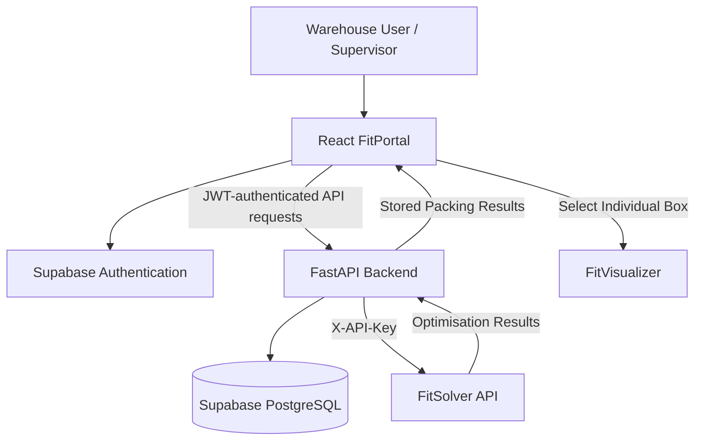

# Thomax × Cosmic Portal MVP

**COMP4050 · Project Perfect Fit**

A responsive carton-optimisation portal built by the **Cosmic Portal** team for COMP4050 project. FitPortal connects warehouse order management with **FitSolver** for packing optimisation and **FitVisualizer** for box-level 3D visualisation.

## Overview

The Portal provides a single workflow for creating and validating orders, selecting available carton types, running packing optimisation, and inspecting the resulting packing plan.

The application supports desktop and mobile layouts, with role-based access for regular users and supervisors.

## Key Features & User Workflow

1. **Authentication:** Register, verify email, log in, log out, and reset passwords through Supabase Authentication.

2. **Dashboard:** Interactive warehouse operations dashboard featuring live order statistics, workflow distribution, an animated order journey, role-based quick actions, and recent orders. Users can navigate directly to filtered order queues.

3. **Create Orders:** Add items with dimensions, weights, quantities, and packing requirements. Import item data or enter information manually. All active carton types are selected by default and can be adjusted.

4. **Manage Orders:** Search and filter orders by status, view orders created by the signed-in user through the **Your Orders** filter, and delete eligible orders individually or in bulk. Dashboard shortcuts open the Orders Queue with the relevant filters applied.

5. **Validate & Optimise:** Supervisors can validate orders and submit them to FitSolver through the FastAPI backend.

6. **Packing Results:** View packed and unpacked item counts, cartons used, weights, and space utilisation.


7. **Packing Plan & Visualisation:** Review carton dimensions, weight, utilisation, and packing arrangements through collapsible box cards. Expand individual cartons to inspect packed-item positions, orientations, and dimensions. Use the dedicated **View** button to open the corresponding FitVisualizer visualisation.


8. **Profiles Management:** Supervisors can assign User/Supervisor roles and manage user accounts, including the recently implemented account-deletion feature.

9. **Integration Monitoring:** Check connectivity and service status for FitPortal API, FitSolver, FitVisualizer, and Supabase.

10. **Export Results:** Download order information and packing results in JSON format.

## Technology Stack

| Component | Technology |
|---|---|
| Frontend | React 19, TypeScript, Vite, Tailwind CSS |
| UI Animations | Motion for React (`motion`) |
| Backend | Python, FastAPI, SQLAlchemy, Pydantic |
| Authentication | Supabase Auth |
| Database | PostgreSQL (Supabase) |
| Packing Optimisation | FitSolver API |
| Visualisation | `@comp4050-fiv/visualizer` |
| Testing | pytest, TypeScript build checks |
| CI/CD | GitHub Actions |

## System Architecture



### Integration Flow

1. Users create and submit orders through the React frontend.
2. FastAPI validates and stores order information in PostgreSQL.
3. The backend sends validated packing requests to FitSolver.
4. FitSolver returns optimised carton arrangements.
5. Results are stored in the database and displayed in FitPortal.
6. Users can open a selected box's 3D visualisation.

**Security:** FitSolver is called from the FastAPI backend rather than directly from the browser. Its API key remains in the backend environment.

## Repository Structure

```text
.
├── frontend/
│   ├── src/
│   │   ├── components/      # Reusable UI components
│   │   ├── pages/           # Application pages
│   │   ├── lib/             # API client and authentication
│   │   └── types/           # TypeScript definitions
│   ├── vendor/              # FitVisualizer package
│   └── package.json
│
├── backend/
│   ├── app/
│   │   ├── routers/         # API endpoints
│   │   ├── auth.py          # Authentication and permissions
│   │   ├── models.py        # Database models
│   │   ├── schemas.py       # Request/response schemas
│   │   ├── solver_client.py # FitSolver integration
│   │   └── main.py          # FastAPI application
│   ├── tests/               # Backend tests
│   ├── schema.sql           # Database schema
│   └── requirements.txt
│
├── docs/                    # API documentation
└── README.md
```

## Installation & Local Setup

### Prerequisites

- Node.js 20.19+ or compatible newer version
- Python 3
- npm
- Supabase project
- FitSolver API access
- Git

### 1. Clone the Repository

```bash
git clone <repository-url>
cd <repository-folder>
```

### 2. Configure Supabase

Create or configure the Supabase project.

Execute the database schema in:

```text
backend/schema.sql
```

Configure Supabase Authentication, including email verification and allowed redirect URLs.

New accounts receive the User role by default.

The first Supervisor can be assigned by an authorised database administrator:

```sql
UPDATE public.profiles
SET role = 'SUPERVISOR'
WHERE user_id = '<supabase-auth-user-uuid>';
```

### 3. Configure the Backend

Navigate to the backend folder:

```bash
cd backend
```

Create a `.env` file with the required configuration:

```dotenv
DATABASE_URL=postgresql://<database-connection-string>

SUPABASE_URL=https://<project-ref>.supabase.co
SUPABASE_ANON_KEY=<supabase-publishable-key>

SOLVER_URL=https://<solver-host>
FITSOLVER_API_KEY=<solver-api-key>

ALLOWED_ORIGINS=http://localhost:5173
```

Create a Python virtual environment:

```bash
python -m venv .venv
```

Activate it.

**Windows PowerShell:**

```powershell
.\.venv\Scripts\Activate.ps1
```

**macOS/Linux:**

```bash
source .venv/bin/activate
```

Install dependencies:

```bash
pip install -r requirements.txt
```

Start the backend:

```bash
python -m uvicorn app.main:app --reload
```

Backend URL:

```text
http://localhost:8000
```

FastAPI documentation:

```text
http://localhost:8000/docs
```

### 4. Configure the Frontend

Open another terminal:

```bash
cd frontend
```

Create a `.env` file:

```dotenv
VITE_SUPABASE_URL=https://<project-ref>.supabase.co
VITE_SUPABASE_PUBLISHABLE_KEY=<supabase-publishable-key>
VITE_API_BASE_URL=http://localhost:8000/api/v1
```

Install dependencies:

```bash
npm ci
```

Start the development server:

```bash
npm run dev
```

Open:

```text
http://localhost:5173
```

The FitVisualizer dependency is bundled under `frontend/vendor/` and installed through the frontend package configuration.

**Important:** Never commit `.env` files or expose FitSolver and Supabase secret keys in frontend code.

## API Endpoints

All endpoints are prefixed with `/api/v1`.

| Feature | API |
|---|---|
| Authentication | `/auth/login`, `/auth/me` |
| Orders | `GET/POST /orders/` |
| Order Details | `GET /orders/{id}` |
| Order Validation | `POST /orders/{id}/validate` |
| Optimisation | `POST /orders/{id}/optimise` |
| Packing Results | `GET /orders/{id}/results` |
| Delete Order | `DELETE /orders/{id}` |
| Bulk Delete | `POST /orders/bulk-delete` |
| Box Types | `/box-types/` |
| Dashboard | `GET /dashboard/summary` |
| Integration | `GET /integration/status` |
| User Profiles | `GET /users/` |
| Role Management | `PUT /users/{id}/role` |
| Delete User | `DELETE /users/{id}` (recent implementation) |

Additional endpoint documentation is available in `backend/README.md` and `docs/api-contract.md`.

## Authentication, Security & User Roles

FitPortal uses Supabase Authentication for account management and JWT-based API authentication.

Passwords are securely managed and hashed by Supabase rather than stored directly in the Portal database.

### User Permissions

| Functionality | User | Supervisor |
|---|---|---|
| Access Dashboard | Yes | Yes |
| Create Orders | Yes | Yes |
| View Orders | Yes | Yes |
| Use Your Orders Filter | Yes | Yes |
| View Packing Results | Yes | Yes |
| Open Visualisation | Yes | Yes |
| Validate Orders | No | Yes |
| Run Optimisation | No | Yes |
| Delete Own Draft/Invalid Orders | Yes | Yes |
| Delete Other Orders | No | Yes, subject to status restrictions |
| Manage User Roles | No | Yes |
| Delete User Accounts | No | Yes |

### Order Ownership

Each created order stores the creator's Supabase user ID in `created_by`.

The **Your Orders** filter displays orders associated with the current account.


### Data Management

- Orders and packing results are stored in PostgreSQL.
- Authorised users can delete orders according to their role and order status.
- Associated packing results are removed when the corresponding order is deleted.
- Automatic order expiration and retention periods are not implemented.

## Testing

### Frontend

```bash
cd frontend
npm run build
```

### Backend

```bash
cd backend
pip install -r requirements-dev.txt
python -m pytest
```

### Recommended MVP Test Scenarios

- Register, verify email, log in and log out.
- Create orders using manual and imported item data.
- Verify active carton types are selected by default.
- Validate and optimise orders.
- Review packing results and individual cartons.
- Open the correct 3D visualisation from each packing-plan box.
- Verify Your Orders filtering.
- Test Supervisor and User permissions.
- Test order deletion and account deletion using disposable accounts.
- Verify mobile responsiveness and navigation.
- Check FitSolver, FitVisualizer, database and backend integration status.

## Deployment

The uploaded repository documentation lists the following frontend deployment:
https://cosmic-portal-frontend.onrender.com

Production configuration requires:

- Frontend and backend environment variables
- Supabase authentication and database connectivity
- Appropriate CORS configuration
- Correct Supabase redirect URLs
- FitSolver API credentials
- Deployment-specific service URLs


## Project Team & Acknowledgements

**Project:** COMP4050 — Project Perfect Fit

**Portal Team:** Cosmic Portal

Cosmic Portal integrates contributions from two other development teams:


- **FitSolver Team:** Carton packing optimisation.
- **FitVisualizer Team:** Interactive 3D carton visualisation.

Developed for the **Thomax** use case as part of Macquarie University's COMP4050 software engineering project.
